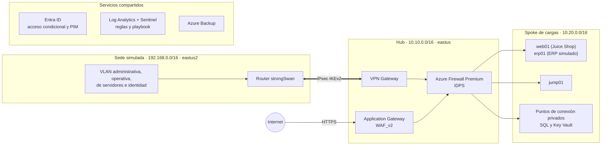

# Laboratorio de nube segura — prototipo de factibilidad

Código Terraform que despliega en Microsoft Azure el prototipo del modelo de seguridad para la adopción de servicios en la nube. Con él se ejecuta el plan de validación V1–V11. El laboratorio reproduce una sede local, unida a la nube por un túnel IPsec, y una arquitectura *hub-spoke* con inspección centralizada. Incluye identidad con Microsoft Entra ID, monitoreo con Microsoft Sentinel y respaldo.

## Arquitectura



El detalle de redes, equipos, reglas y políticas está en [`docs/inventario.md`](docs/inventario.md).

### Dos modos de operación

| Modo | Variable | Contenido | Costo |
|---|---|---|---|
| Base | `perimetro_activo = false` | Redes, VMs, datos, identidad, monitoreo y respaldo | Bajo; las VMs se apagan cada día a las 23:00 |
| Sesión de pruebas | `perimetro_activo = true` | Agrega Azure Firewall Premium, VPN Gateway, Application Gateway WAF_v2 y las rutas | ≈ USD 2.40/h |

El perímetro es efímero: se crea al empezar una sesión de pruebas y se destruye al terminarla. Crearlo tarda de 45 a 60 minutos, casi todo por el VPN Gateway, así que conviene agrupar en una misma sesión las pruebas que lo necesitan.

## Estructura del repositorio

| Ruta | Contenido |
|---|---|
| `main.tf`, `providers.tf`, `backend.tf`, `variables.tf`, `outputs.tf` | Grupos de recursos, proveedores, estado remoto, variables y salidas |
| `red.tf`, `sede.tf`, `dns-interno.tf` | VNets hub, spoke y aislada; sede con router strongSwan; zona privada `interno.lab` |
| `perimetro.tf`, `modules/perimetro/` | Firewall, VPN Gateway, App Gateway WAF y rutas (capa efímera) |
| `computo.tf`, `modules/vm_linux/`, `modules/vm_windows/` | VMs del spoke y CA interna con sus certificados |
| `datos.tf` | Key Vault, Azure SQL con TDE (CMK) y puntos de conexión privados |
| `identidad.tf` | Grupos, usuarios de prueba, cuentas de emergencia, acceso condicional CA01–CA06 y PIM |
| `monitoreo.tf`, `playbook.tf` | Log Analytics, Sentinel, conectores, reglas analíticas y playbook de respuesta |
| `respaldo.tf` | Bóveda de Recovery Services y políticas de respaldo |
| `cloud-init/`, `scripts/` | Configuración inicial de las VMs y script de control de costos |
| `docs/` | Inventario del laboratorio y guía de ejecución de las validaciones |

## Requisitos

- Terraform ≥ 1.9 y la CLI de Azure con la sesión iniciada (`az login`).
- Una suscripción de Azure en la que tengas el rol **Owner**.
- En el inquilino de Entra ID: rol **Global Administrator** para el operador, prueba de **Entra ID P2** activa y **valores predeterminados de seguridad** desactivados.
- Una cuenta de almacenamiento para el estado remoto. Se crea a mano en `rg-proto-tfstate` y se configura en [`backend.tf`](backend.tf), con autenticación de Entra ID.
- Un par de llaves SSH. La pública va en `~/.ssh/lab_azure.pub` (variable `ssh_clave_publica`).

## Despliegue

1. Crea `terraform.tfvars`, que está excluido del repositorio:

   ```hcl
   subscription_id     = "<id de la suscripción>"
   ip_admin            = "<tu IP pública>/32"       # única IP autorizada para SSH y Key Vault
   administradores_lab = ["<object id en Entra>"]   # aprobadores de PIM
   ips_equipo          = []                         # IPs adicionales con acceso a Key Vault
   ```

2. Despliega la capa base:

   ```bash
   terraform init
   terraform apply
   ```

3. Completa los pasos manuales de la [sección 10 del inventario](docs/inventario.md): métodos de autenticación, conector de App Proxy, usuario de SQL para la identidad de erp01, incorporación a PIM, entre otros.

4. Para una sesión de pruebas, activa el perímetro:

   ```bash
   terraform apply -var perimetro_activo=true
   ```

## Control de costos

[`scripts/detener-laboratorio.sh`](scripts/detener-laboratorio.sh) muestra qué está generando costo y permite detenerlo:

```bash
scripts/detener-laboratorio.sh estado     # perímetro, VMs y recursos con costo fijo
scripts/detener-laboratorio.sh pausar     # destruye el perímetro y desasigna las VMs
scripts/detener-laboratorio.sh destruir   # elimina todo el laboratorio y los respaldos residuales
```

## Validación

La guía [`docs/validaciones.md`](docs/validaciones.md) describe, para cada prueba del plan (V1–V11), los requisitos, los pasos, el criterio de aceptación y la evidencia que se debe conservar: conectividad híbrida, acceso condicional, MFA, PIM, segmentación, WAF, IDPS, SIEM, respaldo y reversión.

## Consideraciones conocidas

- **Application Gateway y Key Vault:** el App Gateway lee su certificado a través del punto de conexión privado de Key Vault, directamente por el *peering*. Por eso `snet-seguridad` aplica solo NSG a sus puntos de conexión privados. Si esa lectura pasa por Azure Firewall, el despliegue termina en `InternalServerError`.
- **Script de inicio de erp01:** la extensión CustomScriptExtension limita la línea de comandos a 8 191 caracteres. La configuración HTTPS (certificado de la CA interna) se aplica aparte con Run Command (`scripts/erp-https.ps1`).
- **PIM:** la asignación elegible de User Administrator se hace en el portal, porque el token de la CLI de Azure no incluye el permiso `RoleEligibilitySchedule.ReadWrite.Directory`. PIM para recursos de Azure requiere incorporar el inquilino una vez desde el portal.
- **Acceso condicional:** las políticas se despliegan en modo solo informe (`estado_acceso_condicional`). Se activan después de revisar su efecto, como indica la guía de validación.
- **Ubicación:** las VMs salen a Internet desde IPs de Estados Unidos. Con CA04 activa, un inicio de sesión de Entra hecho desde una VM queda bloqueado.
