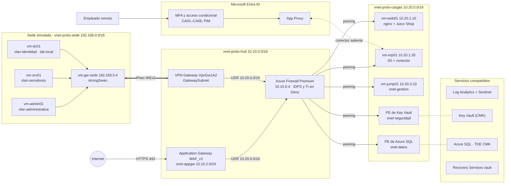

# Inventario del prototipo de factibilidad

Detalle de los recursos que despliega el código Terraform de este repositorio en Microsoft Azure: la nube en la región `eastus` y la sede simulada en `eastus2`. Los nombres usan el prefijo `proto`; `<sufijo>` es una cadena aleatoria de 5 caracteres que garantiza nombres únicos en Azure.

El laboratorio tiene dos modos:

| Modo | Variable | Recursos | Uso |
|---|---|---|---|
| Base | `perimetro_activo = false` | 196 | Estado permanente: redes, equipos, datos, identidad, monitoreo y respaldo |
| Sesión de pruebas | `perimetro_activo = true` | 217 | Agrega Azure Firewall Premium, VPN Gateway, Application Gateway WAF_v2, rutas y sus diagnósticos (≈ USD 2.40/h) |

---

## 1. Arquitectura general

Todo el tráfico entre zonas (sede ↔ spoke, App Gateway ↔ spoke, apps/gestión ↔ datos, spoke → Internet) atraviesa el Firewall cuando el perímetro está activo.

---

## 2. Grupos de recursos

| Grupo | Contenido | Vida útil |
|---|---|---|
| `rg-proto-core` | VNets hub, cargas y aislada; VMs del spoke; Key Vault; SQL; DNS privado; Log Analytics/Sentinel; playbook; bóveda de respaldo. **También el Firewall y el VPN Gateway** (deben estar en el grupo de su VNet) | Persistente (Firewall y VPN Gateway: efímeros) |
| `rg-proto-perimetro` | Política del Firewall, App Gateway y política WAF, IPs públicas del Firewall y del App Gateway, Local Network Gateway, conexión IPsec, tablas de rutas | Efímero |
| `rg-proto-sede` | VNet de la sede, router strongSwan, equipos de prueba, controlador de dominio | Persistente |
| `rg-proto-tfstate` | Cuenta de almacenamiento del estado remoto de Terraform | Creado a mano, fuera de Terraform |

---

## 3. Redes

### 3.1 VNet hub — `vnet-proto-hub` (10.10.0.0/16)

| Subred | Rango | Contenido | NSG |
|---|---|---|---|
| AzureFirewallSubnet | 10.10.0.0/26 | Azure Firewall Premium (`afw-proto`) | No admite NSG |
| GatewaySubnet | 10.10.1.0/27 | VPN Gateway (`vgw-proto`) | No admite NSG |
| snet-appgw | 10.10.2.0/24 | Application Gateway (`agw-proto`) | `nsg-snet-appgw` |

Reglas de `nsg-snet-appgw` (entrada):

| Prioridad | Regla | Origen | Puerto |
|---|---|---|---|
| 100 | permitir-gatewaymanager | GatewayManager | 65200-65535 |
| 110 | permitir-azureloadbalancer | AzureLoadBalancer | * |
| 120 | permitir-https-internet | Internet | 443 |

### 3.2 VNet de cargas de trabajo — `vnet-proto-cargas` (10.20.0.0/16)

| Subred | Rango | Contenido |
|---|---|---|
| snet-apps | 10.20.1.0/24 | vm-web01 (.10), vm-erp01 (.20) |
| snet-datos | 10.20.2.0/24 | Punto de conexión privado de Azure SQL |
| snet-gestion | 10.20.3.0/24 | vm-jump01 (.10) |
| snet-seguridad | 10.20.4.0/24 | Punto de conexión privado de Key Vault |

Cada subred tiene su NSG (`nsg-<subred>`) con una regla final **denegar-resto-vnet** (prioridad 4000) que bloquea cualquier otro tráfico interno.

| Subred | Prioridad | Regla | Origen | Puertos |
|---|---|---|---|---|
| snet-apps | 100 | permitir-https-desde-appgw | 10.10.2.0/24 | 443 |
| | 110 | permitir-https-desde-sede | 192.168.0.0/16 | 443 |
| | 120 | permitir-admin-desde-gestion | 10.20.3.0/24 | 22, 3389 |
| snet-datos | 100 | permitir-sql-desde-apps | 10.20.1.0/24 | 1433 |
| | 110 | permitir-sql-desde-gestion | 10.20.3.0/24 | 1433 |
| | 120 | permitir-sql-desde-firewall | 10.10.0.0/26 | 1433 |
| snet-gestion | 100 | permitir-admin-desde-sede | 192.168.0.0/16 | 22, 3389 |
| snet-seguridad | 100 | permitir-keyvault-desde-cargas | 10.20.0.0/16 | 443 |
| | 110 | permitir-keyvault-desde-appgw | 10.10.2.0/24 | 443 |

Peering hub ↔ cargas con tráfico reenviado permitido; el spoke usa el VPN Gateway del hub (`use_remote_gateways`) solo cuando el perímetro está activo.

### 3.3 VNet de la sede simulada — `vnet-proto-sede` (192.168.0.0/16, región eastus2)

La sede está en otra región: el túnel IPsec cruza Internet, como entre una oficina y la nube. Además, reparte las VMs entre dos regiones dentro de la cuota de 4 vCPU por región de la suscripción.

| Subred | Rango | Contenido |
|---|---|---|
| snet-borde | 192.168.0.0/24 | vm-gw-sede (.4), router strongSwan con IP pública |
| vlan-administrativa | 192.168.10.0/24 | vm-admin01 (.10) |
| vlan-operativa | 192.168.20.0/24 | (vacía) |
| vlan-servidores | 192.168.30.0/24 | vm-srv01 (.10) |
| vlan-identidad | 192.168.40.0/24 | vm-dc01 (.10) |

- `nsg-snet-borde`: permite UDP 500/4500 solo desde la IP del VPN Gateway, SSH solo desde la IP del administrador (`ip_admin`) y el tráfico de 192.168.0.0/16 que el router reenvía hacia 10.10.0.0/16 y 10.20.0.0/16 (el filtrado por puerto lo hace Azure Firewall).
- Las VLAN tienen NSG con las reglas predeterminadas de Azure.
- Tabla de rutas `rt-proto-sede-vlans` en las cuatro VLAN: 10.10.0.0/16 y 10.20.0.0/16 → 192.168.0.4 (router).

### 3.4 VNet aislada de restauración — `vnet-proto-aislada` (10.99.0.0/16)

| Subred | Rango | Uso |
|---|---|---|
| snet-restauracion | 10.99.1.0/24 | Destino de la restauración de VMs (prueba V10). Sin peering ni rutas hacia el resto del laboratorio |

### 3.5 Rutas definidas por el usuario (solo con el perímetro activo)

| Tabla | Subredes | Rutas → 10.10.0.4 (Firewall) | Propagación BGP |
|---|---|---|---|
| `rt-proto-appgw` | snet-appgw | 10.20.0.0/16 | Sí |
| `rt-proto-gateway` | GatewaySubnet | 10.20.0.0/16 | Sí (obligatorio) |
| `rt-proto-spoke` | snet-apps, snet-datos, snet-gestion, snet-seguridad | 0.0.0.0/0, 10.10.2.0/24, 10.20.2.0/24, 192.168.0.0/16 | No |

### 3.6 DNS privado

| Zona | Registros | Enlazada a |
|---|---|---|
| `privatelink.database.windows.net` | SQL → IP privada en snet-datos | hub, cargas, sede |
| `privatelink.vaultcore.azure.net` | Key Vault → IP privada en snet-seguridad | hub, cargas, sede |
| `interno.lab` | `web01` 10.20.1.10, `erp01` 10.20.1.20, `srv01` 192.168.30.10, `app` (TTL 60 s) → 10.20.1.10 o 192.168.30.10 según `servicio_app_activo` | hub, cargas, sede |

### 3.7 IPs públicas

| Recurso | Nombre | Grupo | Vida útil |
|---|---|---|---|
| Router de la sede | `pip-proto-router-sede` | rg-proto-sede | Persistente |
| VPN Gateway | `pip-proto-vpngw` (zonas 1-2-3) | rg-proto-core | Persistente (no cambia entre sesiones) |
| Azure Firewall | `pip-proto-fw` | rg-proto-perimetro | Efímera |
| Application Gateway | `pip-proto-appgw` | rg-proto-perimetro | Efímera |

---

## 4. Equipos (máquinas virtuales)

Todas las VMs: IP privada estática, disco `StandardSSD_LRS` con controlador NVMe, **apagado automático diario a las 23:00** (hora de El Salvador), identidad administrada del sistema, diagnóstico de arranque (consola serie) y **Azure Monitor Agent**. Las Linux usan Ubuntu 24.04 LTS con autenticación solo por llave SSH (`~/.ssh/lab_azure`) y usuario `azureadmin`.

Tamaños: serie F v7 de 1 vCPU (`Standard_F1als_v7`, 2 GB, para Linux; `Standard_F1as_v7`, 4 GB, para Windows), los disponibles para la suscripción de prueba. Total: 3 vCPU en eastus y 4 vCPU en eastus2 (cuota de 4 por región).

### 4.1 Spoke de cargas de trabajo (`rg-proto-core`)

#### vm-web01 — Aplicación web
| Atributo | Valor |
|---|---|
| Sistema / tamaño | Ubuntu 24.04, `Standard_F1als_v7` (1 vCPU, 2 GB) |
| Red | snet-apps, 10.20.1.10, sin IP pública |
| Servicios | **OWASP Juice Shop** (Docker, solo en 127.0.0.1:3000) detrás de **nginx** con TLS 1.2/1.3 en el puerto 443 |
| Certificado | Firmado por la CA interna; CN `web01.interno.lab`, SAN `app.interno.lab` e IP 10.20.1.10 |
| Función | Backend del Application Gateway (sesión TLS 2 del documento); servicio "nube" de la prueba V11 |
| Respaldo | `pol-mejorada-4h` |
| Registros | Syslog (auth, authpriv, daemon, kern, syslog) |

#### vm-erp01 — ERP simulado
| Atributo | Valor |
|---|---|
| Sistema / tamaño | Windows Server 2022 Datacenter Azure Edition, `Standard_F1as_v7` (1 vCPU, 4 GB) |
| Red | snet-apps, 10.20.1.20, sin IP pública |
| Servicios | **IIS** con la página "ERP simulado" en HTTP (80) y HTTPS (443, certificado de la CA interna para `erp01.interno.lab`); ICMP de entrada permitido; HTTP/2 de WinHTTP deshabilitado (requisito del conector) |
| Instalación manual | **Conector de red privada de Entra** (App Proxy) |
| Parches | `AutomaticByPlatform` (orquestación y evaluación de parches de Azure) |
| Identidad | Identidad administrada usada para conectarse a Azure SQL sin contraseña |
| Credencial | Contraseña aleatoria en Key Vault (`vm-erp01-azureadmin`) |
| Respaldo | `pol-mejorada-4h` |
| Registros | SecurityEvent (inicios de sesión, privilegios, cuentas y grupos, borrado del registro) |

#### vm-jump01 — Servidor de salto
| Atributo | Valor |
|---|---|
| Sistema / tamaño | Ubuntu 24.04, `Standard_F1als_v7` (1 vCPU, 2 GB) |
| Red | snet-gestion, 10.20.3.10, sin IP pública |
| Servicios | Herramientas: curl, nmap, netcat, dnsutils, traceroute |
| Función | Único punto de administración hacia snet-apps (22/3389) y snet-datos (1433) |
| Registros | Syslog |

### 4.2 Sede simulada (`rg-proto-sede`, región eastus2)

#### vm-gw-sede — Router de borde
| Atributo | Valor |
|---|---|
| Sistema / tamaño | Ubuntu 24.04, `Standard_F1als_v7` |
| Red | snet-borde, 192.168.0.4, **IP pública** (`pip-proto-router-sede`), reenvío IP habilitado |
| Servicios | **strongSwan** (swanctl): IKEv2, `aes256-sha256-modp2048`, PSK, DPD 30 s, reinicio automático del túnel; tcpdump |
| Selectores de tráfico | Local 192.168.0.0/16; remoto 10.10.0.0/16 y 10.20.0.0/16 |
| Acceso | SSH solo desde `ip_admin`; también sirve como bastión hacia las VLAN |
| Registros | Syslog |

#### vm-admin01 — Equipo de la VLAN administrativa
| Atributo | Valor |
|---|---|
| Sistema / tamaño | Ubuntu 24.04, `Standard_F1als_v7` |
| Red | vlan-administrativa, 192.168.10.10 |
| Servicios | Herramientas de red (curl, nmap, netcat, dnsutils, traceroute) |
| Función | Origen "no autorizado" hacia la zona de datos (V6); cliente de la prueba de reversión (V11) |

#### vm-srv01 — Servidor local
| Atributo | Valor |
|---|---|
| Sistema / tamaño | Ubuntu 24.04, `Standard_F1als_v7` |
| Red | vlan-servidores, 192.168.30.10 |
| Servicios | Herramientas de red; **nginx** con TLS (certificado de la CA interna para `app.interno.lab`) que sirve la página "Aplicación web - servicio local (sede)" |
| Función | Origen de la prueba de conectividad híbrida (V2); servicio local del plan de vuelta atrás (V11) |

#### vm-dc01 — Controlador de dominio
| Atributo | Valor |
|---|---|
| Sistema / tamaño | Windows Server 2022 Datacenter Azure Edition, `Standard_F1as_v7` |
| Red | vlan-identidad, 192.168.40.10 |
| Servicios | **AD DS** con el bosque `lab.local` (NetBIOS `LAB`) y **DNS** con reenviador a 168.63.129.16 |
| Instalación manual | **Microsoft Entra Cloud Sync** (sincronización de hash de contraseñas) |
| Credenciales | Administrador (`vm-dc01-azureadmin`) y DSRM (`vm-dc01-dsrm`) en Key Vault |
| Respaldo | Estado del sistema con el **agente MARS** (diario, 30 días) en `rsv-proto-<sufijo>` |
| Registros | SecurityEvent |

---

## 5. Servicios de plataforma

### 5.1 Key Vault — `kv-proto-<sufijo>`
- Autorización por RBAC, protección de purga, eliminación temporal de 7 días.
- Firewall: denegar por defecto; permitidas las IPs del equipo y los servicios de confianza de Azure; punto de conexión privado en snet-seguridad.
- Contenido:

| Tipo | Nombre | Uso |
|---|---|---|
| Clave RSA 2048 | `clave-tde-sql` | TDE con clave administrada por el cliente; rotación anual |
| Certificado | `cert-appgw` | Listener HTTPS del App Gateway; renovación automática 30 días antes |
| Secretos | `vm-erp01-azureadmin`, `vm-dc01-azureadmin`, `vm-dc01-dsrm` | Credenciales de las VMs Windows |
| Secretos | `entra-<usuario>` (6), `entra-emergencia01`, `entra-emergencia02` | Contraseñas iniciales de Entra ID |

- Roles: Key Vault Administrator (equipo), Key Vault Crypto Service Encryption User (SQL), Key Vault Secrets User (identidad del App Gateway).

### 5.2 Azure SQL — `sql-proto-<sufijo>` / `sqldb-erp`
- Región **centralus** (la suscripción de prueba restringe SQL en eastus). El acceso es solo por el punto de conexión privado de snet-datos (eastus).
- Solo autenticación de Entra ID; administrador: grupo `grp-sql-admins`.
- Acceso público deshabilitado; punto de conexión privado en snet-datos; TLS mínimo 1.2.
- TDE con la clave de Key Vault (CMK) y rotación automática.
- Nivel **S0**; restauración a un punto en el tiempo de 35 días; retención a largo plazo mensual de 12 meses.
- Auditoría enviada a Log Analytics.

### 5.3 CA interna (generada por Terraform)
- `CA Interna Laboratorio`, RSA 2048, vigencia de 1 año.
- Firma los certificados de vm-web01 y vm-srv01; el App Gateway la usa como raíz de confianza del backend.
- Certificado público: `terraform output -raw ca_interna_pem`.

---

## 6. Perímetro (solo con `perimetro_activo = true`)

### 6.1 Azure Firewall Premium — `afw-proto` / política `afwp-proto`
- IDPS en modo **Deny**; inteligencia de amenazas en modo **Deny**.
- SNAT solo hacia la zona de datos (10.20.2.0/24), para que la respuesta del punto de conexión privado regrese por el Firewall.
- Sin inspección TLS.

Reglas de red (colección `segmentacion`, permitir):

| Regla | Origen | Destino | Puertos |
|---|---|---|---|
| sede-a-apps-https | 192.168.0.0/16 | 10.20.1.0/24 | 443 |
| sede-a-gestion-admin | 192.168.0.0/16 | 10.20.3.0/24 | 22, 3389 |
| gestion-a-apps-admin | 10.20.3.0/24 | 10.20.1.0/24 | 22, 3389 |
| apps-a-datos-sql | 10.20.1.0/24 | 10.20.2.0/24 | 1433 |
| gestion-a-datos-sql | 10.20.3.0/24 | 10.20.2.0/24 | 1433 |
| cargas-y-appgw-a-keyvault | 10.20.0.0/16, 10.10.2.0/24 | 10.20.4.0/24 | 443 |
| appgw-a-web01 | 10.10.2.0/24 | 10.20.1.10 | 443 |

Todo lo demás se deniega (por ejemplo, VLAN administrativa → SQL).

Reglas de aplicación (colección `salida-internet`, origen spoke):

| Regla | Destinos | Protocolo |
|---|---|---|
| repositorios-ubuntu | `*.ubuntu.com`, `azure.archive.ubuntu.com` | HTTP/HTTPS |
| docker-hub | `*.docker.io`, `*.docker.com`, `production.cloudflare.docker.com` | HTTPS |
| windows-update | Etiqueta FQDN `WindowsUpdate` | HTTP/HTTPS |
| app-proxy-https | `*.msappproxy.net`, `*.servicebus.windows.net`, endpoints de inicio de sesión de Microsoft | HTTPS |
| app-proxy-revocacion-http | CRL/OCSP de DigiCert y Microsoft | HTTP |
| azure-monitor-agent | `*.handler.control.monitor.azure.com`, `*.ingest.monitor.azure.com`, `*.ods/oms.opinsights.azure.com` | HTTPS |

### 6.2 VPN de sitio a sitio
| Recurso | Configuración |
|---|---|
| `vgw-proto` | VPN Gateway `VpnGw1AZ`, basado en rutas, activo-en espera |
| `lgw-proto-sede` | IP pública del router; red 192.168.0.0/16 |
| `con-proto-sede` | IPsec IKEv2, PSK aleatoria; IKE AES256/SHA256/DH14; IPsec AES256/SHA256/PFS2048; vida de la SA 27000 s |

### 6.3 Application Gateway WAF_v2 — `agw-proto`
- Una instancia; política TLS `AppGwSslPolicy20220101` (TLS 1.2 mínimo).
- Listener HTTPS 443 con `cert-appgw`, leído de Key Vault por la identidad `id-proto-appgw`.
- Backend 10.20.1.10 por HTTPS, con host `web01.interno.lab` validado contra la CA interna; sonda HTTPS `/`.
- Política `wafp-proto`: modo **Prevention**, Microsoft Default Rule Set 2.1, inspección del cuerpo. Exclusiones y reglas desactivadas configurables con `waf_exclusiones` y `waf_reglas_deshabilitadas`.

---

## 7. Identidad (Microsoft Entra ID)

### 7.1 Grupos
| Grupo | Miembros | Uso |
|---|---|---|
| `grp-finanzas` | finanzas01 | Rol funcional |
| `grp-operativo` | operativo01 | Rol funcional |
| `grp-comercial-remoto` | comercial01, comercial02 | Acceso remoto al ERP; sujeto a CA06 |
| `grp-admins-ti` | adminti01, adminti02 | Asignable a roles; roles privilegiados solo por PIM |
| `grp-sql-admins` | Integrantes del equipo | Administrador de Entra de Azure SQL |
| `grp-break-glass` | emergencia01, emergencia02 | Excluido de las políticas de bloqueo |

### 7.2 Usuarios
- **Usuarios de prueba:** `finanzas01`, `operativo01`, `comercial01`, `comercial02`, `adminti01`, `adminti02` (`@<dominio>.onmicrosoft.com`, ubicación de uso SV, cambio de contraseña obligatorio en el primer inicio de sesión).
- **Cuentas de emergencia:** `emergencia01`, `emergencia02`, con Global Administrator permanente, contraseña de 32 caracteres y alerta en Sentinel ante cualquier inicio de sesión.

### 7.3 Acceso condicional
Se crean en modo **solo informe** (`estado_acceso_condicional`) y luego se activan.

| Política | Alcance | Control |
|---|---|---|
| CA01 - MFA para todos los usuarios | Todos, excepto break-glass | MFA |
| CA02 - Bloquear autenticación heredada | Todos; clientes Exchange ActiveSync y otros | Bloquear |
| CA03 - Administradores con MFA resistente a phishing | grp-admins-ti | Fortaleza "Phishing-resistant MFA" |
| CA04 - Bloquear inicios de sesión fuera de El Salvador | Todos, excepto break-glass; ubicación ≠ "El Salvador" | Bloquear |
| CA05 - MFA para la administración de Azure | Todos, excepto break-glass; Windows Azure Service Management API | MFA |
| CA06 - Comercial remoto solo desde plataformas aprobadas | grp-comercial-remoto; plataformas distintas de Windows, macOS, iOS y Android | Bloquear |

### 7.4 PIM
| Rol | Alcance | Elegible | Política |
|---|---|---|---|
| Contributor (Azure) | rg-proto-core | grp-admins-ti (90 días) | Máximo 4 h, justificación y **aprobación** obligatorias |
| User Administrator (Entra) | Directorio | grp-admins-ti (asignación en el portal) | Se configura en el portal: máximo 4 h, justificación, sin aprobación |

---

## 8. Monitoreo y respuesta

### 8.1 Log Analytics + Microsoft Sentinel — `law-proto-<sufijo>`
- PerGB2018, retención de 90 días, tope de ingesta de 5 GB/día.

| Fuente | Mecanismo | Tablas |
|---|---|---|
| Entra ID | Diagnóstico de Entra | SigninLogs, AADNonInteractiveUserSignInLogs, AADServicePrincipalSignInLogs, AuditLogs |
| Suscripción | Diagnóstico de la actividad | AzureActivity |
| Key Vault | Diagnóstico (auditoría) | AzureDiagnostics |
| Azure SQL | Auditoría extendida | AzureDiagnostics (SQLSecurityAuditEvents) |
| Azure Firewall | Diagnóstico, tablas dedicadas | AZFWNetworkRule, AZFWApplicationRule, AZFWIdpsSignature, … |
| Application Gateway | Diagnóstico, tablas dedicadas | AGWAccessLogs, AGWFirewallLogs, … |
| VMs Linux (5) | AMA + `dcr-proto-linux-syslog` | Syslog |
| VMs Windows (2) | AMA + `dcr-proto-windows-seguridad` | SecurityEvent |

### 8.2 Reglas analíticas (cada 5 min, ventana de 10 min)
| Regla | Severidad | Condición |
|---|---|---|
| Inicio de sesión con cuenta de emergencia | Alta | Cualquier registro de emergencia01/02 en SigninLogs |
| Firma de IDPS detectada en Azure Firewall | Alta | Cualquier registro en AZFWIdpsSignature |
| Ráfaga de solicitudes bloqueadas por el WAF | Media | ≥ 10 bloqueos de una misma IP |
| Fuerza bruta contra cuentas de Entra ID | Alta | ≥ 5 errores 50126 o 50053 (cuenta bloqueada) para un mismo usuario |

Consulta guardada: **V9 - Fuentes con datos en las últimas 24 h**.

### 8.3 Playbook — `pb-proto-deshabilitar-usuario`
- Logic App con disparador de incidente de Sentinel e identidad administrada.
- Deshabilita en Entra ID las cuentas del incidente (Microsoft Graph, `User.ReadWrite.All`) y agrega un comentario al incidente.
- Regla de automatización **Deshabilitar cuenta ante fuerza bruta**, asociada solo a la regla de fuerza bruta.

---

## 9. Continuidad

### 9.1 Azure Backup — `rsv-proto-<sufijo>`
- Almacenamiento con redundancia geográfica (GRS); eliminación temporal de 14 días siempre activa.

| Política | Programación | Retención | VMs | RPO |
|---|---|---|---|---|
| `pol-mejorada-4h` (V2) | Cada 4 h | Diarias 30 días; mensuales 12 meses; instantáneas 7 días | vm-erp01, vm-web01 | 4 h |

- Controlador de dominio: estado del sistema con el agente MARS (diario, retención de 30 días, RPO de 24 h). Una bóveda solo protege VMs de su región, y MARS no tiene esa limitación.
- Base de datos: copias automáticas de Azure SQL (PITR de 35 días, RPO de 15 min) y LTR mensual de 12 meses.
- Entorno de restauración: `vnet-proto-aislada` y la cuenta de transición `stprotorest<sufijo>`.

### 9.2 Plan de vuelta atrás
- Variable `servicio_app_activo`: `nube` (app.interno.lab → vm-web01) o `local` (app.interno.lab → vm-srv01).

---

## 10. Configuración manual (fuera de Terraform)

| Paso | Dónde | Necesario para |
|---|---|---|
| Activar la prueba de Entra ID P2 | Centro de administración de Entra | Acceso condicional, PIM, registros de inicio de sesión |
| Desactivar los valores predeterminados de seguridad | Entra ID → Propiedades | Acceso condicional |
| Asignar Global Administrator al operador de Terraform | Entra ID → Roles | Capa de identidad y diagnóstico de Entra |
| Métodos de autenticación: SMS y voz desactivados; Authenticator y FIDO2/passkey activados | Entra ID → Métodos de autenticación | V4 |
| Incorporar el inquilino a PIM para recursos de Azure (abrir la sección una vez) | PIM → Recursos de Azure | Política y asignación elegible de Contributor (V5) |
| Asignar grp-admins-ti como elegible para User Administrator y configurar su política (4 h, justificación) | PIM → Roles de Microsoft Entra | V5 |
| Registrar passkey o FIDO2 de adminti01/02 y de las cuentas de emergencia | Mi información de seguridad | CA03, V5 |
| `CREATE USER [vm-erp01] FROM EXTERNAL PROVIDER` | sqlcmd local por túnel SSH a través de jump01 (ver V10 en `validaciones.md`) | Conexión del ERP a SQL |
| Instalar y registrar el conector de red privada en vm-erp01 | Entra → Global Secure Access → Conectores | App Proxy |
| Publicar el ERP (`https://erp01.interno.lab`) con preautenticación de Entra ID y asignar grp-finanzas y grp-comercial-remoto | Entra → Aplicaciones empresariales | V3 |
| Instalar Microsoft Entra Cloud Sync en vm-dc01 | vm-dc01 | Identidad híbrida |
| Instalar el agente MARS en vm-dc01 y programar la copia diaria del estado del sistema (30 días) | vm-dc01 y bóveda `rsv-proto-<sufijo>` | Respaldo del DC (Tabla 19) |
| Agregar el envío de correo al playbook (conector Office 365) | Diseñador de Logic Apps | V9 (notificación) |
| Alerta de presupuesto | Cost Management | Control de costos |

---

## 11. Diferencias frente al documento

- La sede es una VNet de Azure con un router strongSwan (sin firewall físico).
- La PSK de la VPN viaja en el `custom_data` del router.
- El ERP es simulado (IIS) y comparte VM con el conector de App Proxy.
- Una VM de aplicación web (el documento indica dos detrás del App Gateway).
- Un controlador de dominio (el documento indica dos).
- VMs de 1 vCPU de la serie F v7 en lugar de los tamaños B (restricción de la suscripción de prueba), con la sede en otra región por la cuota de 4 vCPU por región.
- Certificados autofirmados con una CA interna generada por Terraform.
- Firewall, App Gateway y VMs sin zonas de disponibilidad (solo el VPN Gateway es zonal); App Gateway con una instancia fija.
- Key Vault con acceso público restringido a las IPs del equipo.
- Zonas DNS privadas enlazadas directamente a la VNet de la sede (en producción: DNS Private Resolver).
- El Firewall aplica SNAT hacia la zona de datos; la auditoría de SQL ve la IP del Firewall como origen.
- Sin inspección TLS en el Firewall.
- Passkey en lugar de llave FIDO2 física (si aplica).
- Las contraseñas de las cuentas de emergencia se custodian en Key Vault (en producción: resguardo físico).
- El Firewall y el VPN Gateway están en el grupo de recursos de la VNet hub.
- La restauración de la base de datos (V10) crea una base nueva en el mismo servidor.
- Azure SQL está en centralus y no en eastus (restricción de la suscripción de prueba); se accede igual por el punto de conexión privado.
